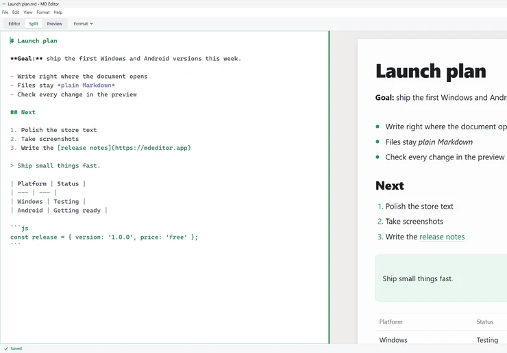
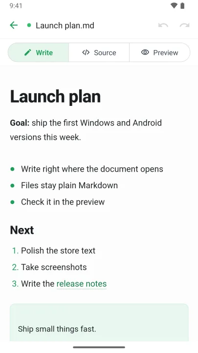

# MD Editor

**MD Editor ([mdeditor.app](https://mdeditor.app)) is a free, light Markdown editor for Windows, Linux and Android, made by ZORYA.** MD Editor for Mac, iPhone and iPad is coming to the App Store.

It highlights Markdown as you type, shows hard-to-read Markdown as a clean rendered page, and edits plain .md files where they are, so you and your AI work on the same files. No account, no analytics, no tracking, no ads.

[Website](https://mdeditor.app) · [FAQ](https://mdeditor.app/#faq) · [Report a bug](https://github.com/zorya-official/mdeditor/issues/new/choose) · [Privacy policy](https://mdeditor.app/privacy.html) · [support@mdeditor.app](mailto:support@mdeditor.app)

<picture>
  <source media="(prefers-color-scheme: dark)" srcset="images/windows-split-dark.webp">
  
</picture>
<picture>
  <source media="(prefers-color-scheme: dark)" srcset="images/android-write-dark.webp">
  
</picture>

This repository is MD Editor's public home on GitHub: this page and the issue tracker for bug reports and ideas. Release notes for each version are on [What's new](https://mdeditor.app/whats-new/). The app's source code is not published here.

## Download

| Platform | Runs on | Store |
| --- | --- | --- |
| Windows | Windows 10 and Windows 11 | [Microsoft Store](https://apps.microsoft.com/detail/9N89RHKWLKV5?mode=full) |
| Linux | x64 and arm64: a .deb for Ubuntu 22.04 or later and Debian 12 or later, a .tar.gz for other distributions | [GitHub Releases](https://github.com/zorya-official/mdeditor/releases/latest) |
| Android | Android 8.0 or later | Google Play: coming soon |
| Mac | macOS 14 or later | Mac App Store: coming soon |
| iPhone and iPad | iOS and iPadOS 17 or later | App Store: coming soon |

Store links appear here and on [mdeditor.app](https://mdeditor.app) as each store goes live.

## What it does on Windows, Linux and Android

- Free, with no account, no analytics, no tracking and no ads.
- Light: no account, no setup and no library to import into; it opens straight into the file.
- Opens plain .md files where they are and saves them as you type ("Saved" means the file is written).
- Highlights Markdown as you type: headings, bold, links and lists stand out.
- Shows the document as a clean page: headings, lists, task lists, tables, footnotes, quotes, code and pictures, in light or dark. Windows, Linux and Android use the same renderer.
- The preview reads GitHub Flavored Markdown (headings, lists, task lists, tables, strikethrough, quotes, code, links and pictures), plus footnotes, definition lists, highlights, and superscript and subscript.
- Works offline. Only pictures linked from the web need a connection.
- Seven languages: English, Korean, Japanese, Chinese (Simplified and Traditional), Spanish and Ukrainian.

### Windows and Linux (the same desktop app)

- Editor, Split and Preview views, one shortcut apart (Ctrl+1, Ctrl+2, Ctrl+3). Split scrolls both sides together.
- Enter continues lists. Format menu and keyboard shortcuts.
- Find and replace. Export to PDF.
- Open a .md or .markdown file from File Explorer or your Linux file manager, drop it on the window, or use Open Recent.
- When another app or an AI tool changes the file you have open, MD Editor notices. A document without unsaved edits shows the new version ("Updated from disk", and the change can be undone). With unsaved edits it asks: Keep Both (the default), Use Disk Version, or Keep My Edits. It never overwrites the other version.
- On Linux, the .deb puts MD Editor among your apps and under Open With for Markdown files, and `mdeditor` starts it from a terminal. It does not update itself: new versions appear on [Releases](https://github.com/zorya-official/mdeditor/releases).

### Android

- Documents open in Write: you write right on the rendered page, and the file stays plain Markdown. A formatting bar above the keyboard: bold, italics, strikethrough, links, headings and lists.
- Source view with live syntax highlighting, and Preview, one tap away. Settings › Open Documents In chooses the view documents open in (Write by default). Undo and redo.
- Open a .md file with Android's file picker, from your phone or a storage app, or choose MD Editor when another app opens one.
- A small download: the app bundle is under 3 MB.

## Mac, iPhone and iPad (coming to the App Store)

One app for Mac, iPhone and iPad. It is not available yet.

- Write right on the rendered page: headings look like headings, bold looks bold, and no Markdown symbols get in your way. The file stays plain Markdown, and what you did not edit stays exactly as it was.
- Write view: one clean sheet of paper. Select text and a small toolbar formats it. On iPhone, a formatting bar above the keyboard.
- Source view with live syntax highlighting, when you want the Markdown itself.
- Split view and a live preview on Mac and iPad.
- Open, edit and save .md files where they are, with Open Recent and drag and drop.
- Optional free sync through your own private iCloud, across Mac, iPhone and iPad.
- On Mac, when another app or an AI tool changes the file you have open, MD Editor notices; with unsaved edits it asks whether to keep both versions, use the one on disk, or keep yours.
- Export to PDF on Mac. Full menus, keyboard shortcuts and Find on Mac.
- No accounts, no analytics, no tracking, no ads. Works fully offline.

## What MD Editor does not do

- No sync on Windows, Linux or Android. (Free iCloud sync is only in the Apple app.)
- The Android app does not reload a file when another app changes it; that notice is on Windows and Linux (and in the coming Mac app).
- The preview has no math, no diagrams (Mermaid) and no code syntax colouring.

## Questions

**How can I read Markdown from ChatGPT, Claude or Gemini as a formatted page?**
Save the answer as a .md file and open it in MD Editor, or paste it into a new document. The preview shows its headings, lists, tables and code as a clean page, in light or dark mode.

**Can I work on the same Markdown file as an AI agent?**
Yes. MD Editor edits plain .md files in place and saves as you type, so an AI agent reads your latest text. On Windows and Linux, when an AI agent changes a file you have open, MD Editor shows the new version. If you have unsaved edits, it asks whether to keep both versions, use the one on disk, or keep yours.

**Is MD Editor free? Do I need an account?**
Yes, it's free, with no ads and no in-app purchases. You don't need an account.

**Does MD Editor work offline? Does it track me?**
It works fully offline; only images linked from the web need a connection. It has no analytics and no tracking, and the developer never sees your documents.

More answers are in the [FAQ](https://mdeditor.app/#faq).

## Feedback

- Bug reports and ideas: [open an issue](https://github.com/zorya-official/mdeditor/issues/new/choose). Issues are public, so please don't attach private documents; a short sample that shows the problem is enough.
- Anything you'd rather not post in public: [support@mdeditor.app](mailto:support@mdeditor.app).

## Languages

The apps and the website come in seven languages, and every page says the same things:
[English](https://mdeditor.app/) · [한국어](https://mdeditor.app/ko/) · [日本語](https://mdeditor.app/ja/) · [简体中文](https://mdeditor.app/zh-hans/) · [繁體中文](https://mdeditor.app/zh-hant/) · [Español](https://mdeditor.app/es/) · [Українська](https://mdeditor.app/uk/)

## About

MD Editor is made by ZORYA. ChatGPT, Claude and Gemini answer in Markdown, and MD Editor shows that Markdown as a page; MD Editor is not affiliated with OpenAI, Anthropic or Google.
